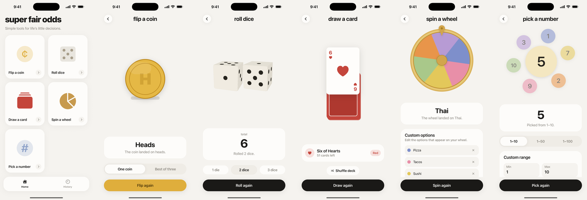

# super fair odds

Five tactile randomizers for iOS. Flip a coin, roll dice, draw a card, spin a
wheel, pick a number — and nothing else. The objects carry the personality, so
the chrome doesn't have to.



No backend, no accounts, no network calls, no analytics. Everything happens on
the device and stays there.

## The activities

| | What it does |
| --- | --- |
| **Flip a coin** | One flip, or best of three. A real 3D-ish flip that swaps faces only at the moment the coin is edge-on. |
| **Roll dice** | One to three dice, as actual cubes built from per-face matrices rather than flat sprites. |
| **Draw a card** | Draws *without replacement* — the deck depletes, visibly thins, and reshuffles once exhausted. |
| **Spin a wheel** | Your own options, persisted. The pointer never rotates; it flicks as dividers pass it. |
| **Pick a number** | Any range. One hero number, ringed by samples from the same range for context. |

Every result is written to a local history tab, one entry per outcome — a
best-of-three series logs the series, not three flips.

## Running it

```bash
npm install
npx expo start --ios
```

Requires Expo Go on the simulator or device. **Do not bump the dependency
versions** without reading [`AGENTS.md`](AGENTS.md) first — see below.

## Notes for anyone reading the source

Most of what's interesting here is written up in [`CLAUDE.md`](CLAUDE.md)
(architecture and design decisions) and [`AGENTS.md`](AGENTS.md) (Expo/build
traps). The parts most likely to bite:

- **Three version pins are load-bearing.** `react-native-reanimated` must be
  exactly `4.1.1` and `react-native-worklets` exactly `0.5.1`. A caret or tilde
  resolves to versions that call JSI HostFunctions absent from Expo Go's
  bundled binary, and the app dies at startup with `Exception in HostFunction:
  <unknown>` and no JS stack.

- **The dice are genuinely 3D, the hard way.** React Native 0.81 has no
  `translateZ` shorthand, won't allow `matrix` beside other transform keys, and
  — decisively — has no `transformStyle: preserve-3d`, so a child's 3D
  transform is flattened into its parent's plane. A die therefore isn't a
  rotating container of faces; each face is a leaf view carrying one fully
  composed matrix, rebuilt per frame in a worklet.

- **Anything called from a worklet must itself be marked `'worklet'`.** An
  unmarked module-scope helper takes the whole app down with an opaque
  `SIGABRT` and no JS stack. Relatedly, `Easing` curves are built inside
  animation functions — at module scope `Easing.bezier` crashes the worklet
  runtime before anything renders.

- **Outcome and animation are separate everywhere.** The hook decides what
  happens; the animation is told, and never asks where the answer came from.

## License

MIT — see [`LICENSE`](LICENSE).
